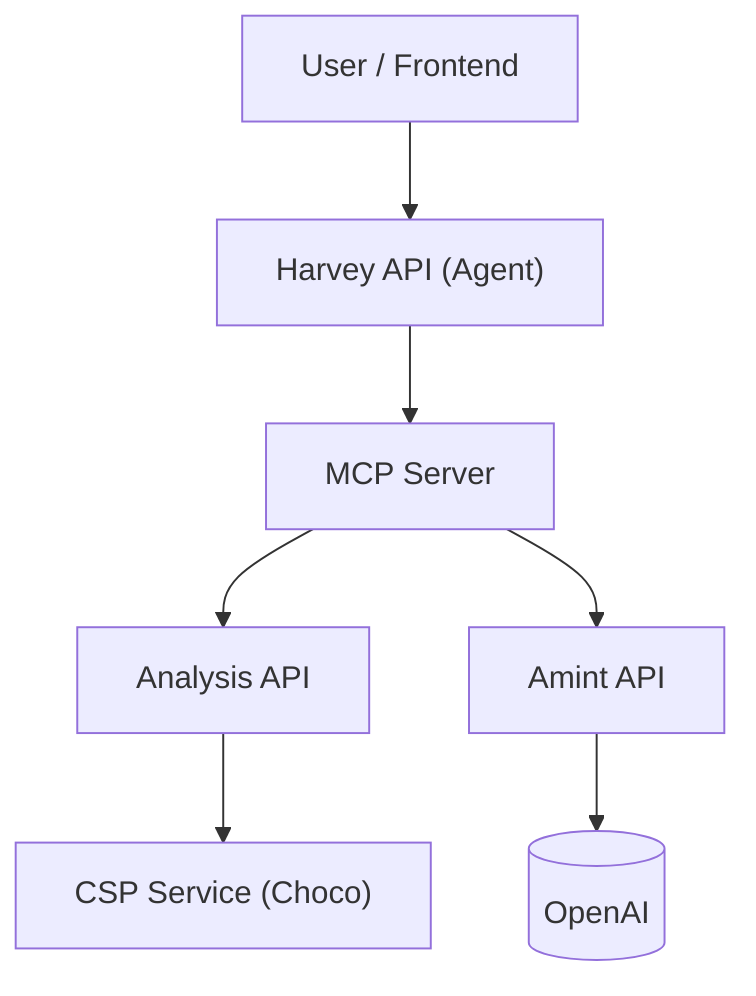

# Pricing Intelligence

Pricing Intelligence is an advanced AI-powered platform designed to analyze, reason about, and extract insights from SaaS pricing models. It combines Large Language Models (LLMs) with rigorous Constraint Satisfaction Problem (CSP) solvers to provide accurate, grounded answers to complex pricing questions. This is part of the contributions of the paper "Pricing Intelligence: Rethinking IS Engineering in Volatile SaaS Environments".

## 🚀 Overview

The system allows users to:
- **Extract** structured pricing models (Pricing2Yaml) from raw website URLs.
- **Analyze** pricing configurations mathematically (validity, feature combinations).
- **Optimize** plan selection based on user requirements (e.g., "Cheapest plan with SSO and 50 users").
- **Interact** via a natural language chat interface powered by the **Harvey** agent.

## 🏗 Architecture

The project is composed of several microservices working in concert:



### Services

| Service | Directory | Description |
|---------|-----------|-------------|
| **Harvey API** | `harvey_api/` | The AI Agent implementing the **ReAct** pattern. It orchestrates tools to answer user queries. |
| **MCP Server** | `mcp_server/` | Implements the **Model Context Protocol**. Exposes tools like `subscriptions`, `optimal`, and `iPricing` to the agent. |
| **Analysis API** | `analysis_api/` | Node.js/TypeScript service. Handles the core logic for pricing analysis, validation, and statistics. |
| **CSP Service** | `csp/` | Java-based service wrapping the **Choco** constraint solver. Performs the heavy mathematical lifting for validity and optimization. |
| **Amint API** | `src/` | Python service responsible for **extracting** pricing data from unstructured sources (URLs) and converting them to the `Pricing2Yaml` format. |
| **Frontend** | `frontend/` | React/Vite application providing the chat interface and visualization. |

## ✨ Key Features

### 🤖 Harvey Agent
Harvey is a specialized agent that follows the **ReAct (Reasoning + Acting)** pattern.
- **Grounding**: It verifies feature names and limits against the actual YAML data before querying tools.
- **Optimization**: Reduces LLM hallucinations by delegating math and logic to the Analysis API.
- **Context Aware**: Can compare multiple pricing models simultaneously (e.g., "Compare HubSpot vs. Salesforce").

### 🛠 MCP Tools
The system exposes several powerful tools via MCP:
- **`iPricing`**: Downloads and structures pricing data from a URL.
- **`subscriptions`**: Enumerates all valid plan configurations given a set of filters.
- **`optimal`**: Finds the best (cheapest/most expensive) configuration satisfying user constraints.
- **`validate`**: Checks if a pricing model is mathematically consistent.
- **`summary`**: Provides high-level statistics about a pricing model.

## 🚦 Getting Started

### Prerequisites
- Docker & Docker Compose
- OpenAI API Key (for HARVEY and A-MINT services)

### Installation

1. **Clone the repository**:
   ```bash
   git clone https://github.com/SCORELabUS/Pricing-Intelligence-Interpretation-Process.git
   cd Pricing-Intelligence-Interpretation-Process
   ```

2. **Configure Environment**:
   Create a `.env` file (or ensure `api_keys.py` / environment variables are set) with your API keys:
   ```bash
   export HARVEY_API_KEY="sk-..."
   export AMINT_API_KEY="sk-..."
   # For detailed custom instructions, visit: https://github.com/isa-group/A-MINT-repo
   ```

3. **Run with Docker Compose**:
   ```bash
   docker-compose up --build
   ```

### ⚙️ Configuration

#### Changing the OpenAI Model
In `docker-compose.yml`, the Harvey agent uses `gpt-5-nano`. To switch to a different model, change the `OPENAI_MODEL` environment variable of the `harvey-api` service:

```yaml
  harvey-api:
    # ...
    environment:
      - OPENAI_MODEL=gpt-5-nano
      # ...
```

If `OPENAI_MODEL` is not set at all (for example, when running `harvey_api` outside Docker Compose), HARVEY falls back to `gpt-5`.

#### Using an OpenAI-compatible endpoint (e.g., a self-hosted model)
Both HARVEY and A-MINT can call any API compatible with OpenAI's (Ollama, vLLM, LM Studio or a compatible provider) through environment variables alone. When they are not set, everything keeps using `https://api.openai.com/v1` with the models above.

| Service | Variable | Purpose | Default |
|---------|----------|---------|---------|
| `harvey-api` | `OPENAI_BASE_URL` | Base URL of the API HARVEY calls | OpenAI SDK default (`https://api.openai.com/v1`) |
| `harvey-api` | `OPENAI_MODEL` | Model HARVEY uses | `gpt-5-nano` in compose |
| `harvey-api` | `OPENAI_API_KEY` | Key for that API | `${HARVEY_API_KEY}` |
| `mcp-server` | `AMINT_LLM_BASE_URL` | Base URL A-MINT calls to extract pricings | `https://api.openai.com/v1` |
| `mcp-server` | `AMINT_LLM_MODEL` | Model A-MINT uses for extraction | `gpt-5.2` |
| `mcp-server` | `AMINT_LLM_BETTER_MODEL` | Model A-MINT uses for its higher-quality steps | `gpt-5.2` |
| `a-mint-api` | `OPENAI_API_KEY` / `OPENAI_API_KEYS` | Key (or comma-separated keys) A-MINT sends to that API | `${AMINT_API_KEY}` / `${AMINT_API_KEYS}` |

The MCP server sends the A-MINT model and base URL with each transformation request; the key stays in the `a-mint-api` service. Cached pricings are keyed by model and base URL, so changing either extracts the pricing again.

Example with [Ollama](https://ollama.com) running on the host:

```yaml
  a-mint-api:
    environment:
      - OPENAI_API_KEY=ollama            # Ollama ignores the key, but one must be set
      # ...

  mcp-server:
    environment:
      - AMINT_LLM_BASE_URL=http://host.docker.internal:11434/v1
      - AMINT_LLM_MODEL=qwen3:32b
      - AMINT_LLM_BETTER_MODEL=qwen3:32b
      # ...

  harvey-api:
    environment:
      - OPENAI_API_KEY=ollama
      - OPENAI_BASE_URL=http://host.docker.internal:11434/v1
      - OPENAI_MODEL=qwen3:32b
      # ...
    # On Linux, also map the host:
    # extra_hosts:
    #   - "host.docker.internal:host-gateway"
```

> [!WARNING]
> HARVEY needs a model that supports tool calling and JSON output: it plans which MCP tools to call as a JSON document, and models that cannot produce it reliably fail to plan or answer. HARVEY calls `/chat/completions` with `reasoning_effort="high"`, so the endpoint must accept (or ignore) that parameter. The published quality of HARVEY and A-MINT was measured with commercial OpenAI models; results with other models may differ.

### Accessing the Services

- **Frontend**: http://localhost:5173 (or configured port)
- **Harvey API**: http://localhost:8086
- **MCP Server**: http://localhost:8085
- **Analysis API**: http://localhost:8002
- **Amint API**: http://localhost:8001
- **CSP Service**: http://localhost:8000

## 📦 Published container images

Every release (`vX.Y.Z` tag) publishes one image per service to the GitHub Container Registry, tagged with the version without the leading `v` (release `v1.3.0` → tag `1.3.0`, plus `1.3`). Images are built for `linux/amd64`.

| Service | Directory | Image | Port | Needs an OpenAI key |
|---------|-----------|-------|------|---------------------|
| Harvey API | `harvey_api/` | `ghcr.io/scorelabus/harvey` | 8086 | Yes |
| A-MINT API | `src/` | `ghcr.io/scorelabus/a-mint` | 8000 (8001 in compose) | Yes (extraction from URLs) |
| MCP Server | `mcp_server/` | `ghcr.io/scorelabus/pi-mcp-server` | 8085 | No |
| Analysis API | `analysis_api/` | `ghcr.io/scorelabus/pricing-analysis-engine` | 3000 (8002 in compose) | No |
| CSP Service (Choco) | `csp/` | `ghcr.io/scorelabus/choco-pricing-analysis-engine` | 8000 | No |

```bash
docker pull ghcr.io/scorelabus/harvey:1.3.0
```

These images are the AI services used by [SPHERE](https://github.com/SCORELabUS/SPHERE). Each SPHERE release pins them by version and digest in its Docker Compose files, so a SPHERE release always runs the same build of these services.

## 📝 Usage Example

1. Open the Frontend.
2. Ask a question: *"What is the cheapest plan for Buffer (https://buffer.com/pricing) that includes 10 channels?"*
3. **Harvey** will:
   - Call `iPricing` to extract the model from the URL.
   - Plan an `optimal` search with filters `{"usageLimits": [{"channels": 10}]}`.
   - Return the exact plan name and cost, grounded in the extracted data.

## 📄 License

This project is released under the [MIT License](LICENSE).
